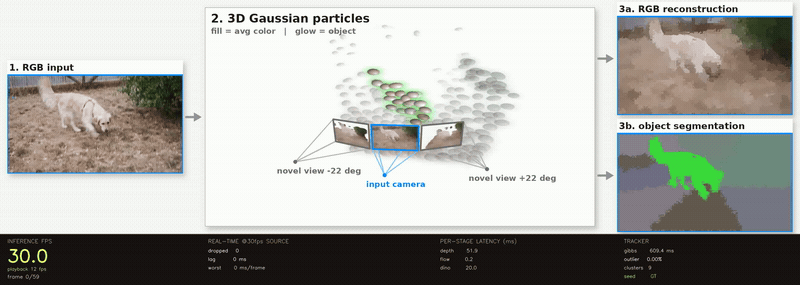
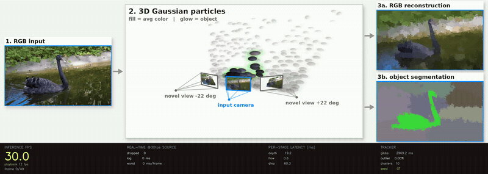

# StreamingVision

**Real-time Gaussian-particle tracking from a streaming video.** Each frame is
turned into relative depth (Depth-Anything V2), optical flow (SEA-RAFT), and DINOv2
features, which drive a **GenMatter++ Gibbs tracker** that maintains a persistent
cloud of 3-D Gaussian "particles" stuck to the scene. The visualization draws the
tracker's latent state — blob means/covariances and cluster assignments.
The detailed offline figure uses flow-guided display stabilization; raw captures
remain available through `--raw-particles` and the dedicated stability comparison script.

> The real-time version of **[GenMatter](https://github.com/esli999/GenMatter)** — bringing its
> motion tracking and segmentation to live video. [Original paper](https://arxiv.org/abs/2604.22160).




*Offline figures place the input beside the 3D particle scene, with inferred
segmentation and 2.5D surfaces below and particle-model renderings at the
initial camera and two reposed cameras. The GIFs above are the earlier live-demo assets.*

## Quickstart

One-time: create the env and clone the optical-flow code (details in
[Setup](#setup)). Model weights download from Hugging Face on first use; the first
run also pays a ~30–90 s JIT + K-means warm-up.

```bash
# 1. Render the sample with its local frame-0 mask (or supply --seed-mask):
python scripts/render_unified.py --videos test --preset quality
#    -> runs/unified_quality/output/test_unified.mp4

# 2. Run the live, multi-threaded streaming demo (real-time perception overlay):
python render_demo.py --source assets/test.mp4 --duration 10 --out runs/streaming_demo.mp4

# 3. The featured figures on DAVIS (after fetching the dataset, see Setup):
python scripts/render_unified.py --videos dog blackswan --out-dir runs/davis_figures
```

`--source` accepts an MP4/MOV or image directory with `--seed-mask`; optionally
choose object instances using `--foreground-ids`. `--videos` resolves named DAVIS
or custom clips and their initial masks. `--stage render` reuses the saved state
without loading inference models; `--stage benchmark` measures inference alone.
Presets live in `configs/unified.yaml`. See
[legacy particle rendering](docs/RENDER_PARTICLES.md) for the older 2×3 layout.

For the separate, simplified slide layout, run
`python scripts/render_simplified_showcase.py` after the detailed showcase exports
exist in `runs/unified_quality/animal_percepts` and `percept_debug`. This keeps the
input, inference FPS and particle scene, with the three RGB views arranged
left-to-right as **Pose 2 → Initial → Pose 1**, matching the frustums. New movies,
still figures and a gallery are saved to `runs/unified_quality/screenshot_slide_layout`.
Use `--preview-only` for stills or a fresh `--out-dir` for another export; existing
movies and galleries are never replaced.

For a matching set focused on mid-level vision, run
`python scripts/render_midlevel_showcase.py`. It renders blackswan, bear, elephant
and dog at 4096×2304 (16:9), with one unlabeled frustum above three large panels:
segmentation, deformable-object surface and background surface. It reuses the
saved particle states and cameras from `animal_percepts`, without inference or
novel-view panels. Movies, stills and the player go to the separate
`runs/unified_quality/midlevel_slide_layout_v2` folder. A rounded blue branch links
the frustum directly to the three readouts. `--preview-only` and a fresh
`--out-dir` are supported; earlier exports are preserved.

## Validate the demos without replacing assets

Run these commands from the repository root in the `streamingvision` environment.
Keep `numpy<2` as specified in `requirements.txt`: NumPy 2.x breaks GenJAX / TensorFlow
Probability seed initialization. If an existing environment has drifted, restore it
with `python -m pip install 'numpy<2'` in a dedicated demo environment.

```bash
python -m pytest tests -q

# Use a fresh temporary directory for all validation outputs.
DEMO_CHECK_DIR=$(mktemp -d /tmp/streamingvision-check.XXXXXX)
python render_demo.py --source assets/test.mp4 --duration 10 \
  --out "$DEMO_CHECK_DIR/streaming_demo.mp4"
python scripts/render_unified.py --videos test --preset fast \
  --max-frames 24 --target-duration 0 --out-dir "$DEMO_CHECK_DIR"

# Decode both files fully; a successful process alone does not validate the MP4.
ffmpeg -v error -xerror -i "$DEMO_CHECK_DIR/streaming_demo.mp4" -f null -
ffmpeg -v error -xerror -i "$DEMO_CHECK_DIR/test_unified.mp4" -f null -
```

Also check the logs for worker exceptions and nonzero tracker activity, and inspect
frames for populated perception, particle, reconstruction, and segmentation panels.
The particle CLI exits nonzero if any requested render fails.

The demo source, launcher, configs, vendored tracking core, bundled `assets/test.mp4`,
and README GIFs are tracked. Generated MP4s, datasets, model weights, caches, and
`third_party/` checkouts are intentionally ignored; install SEA-RAFT as described
in [Setup](#setup). Validation output does not need to be committed.

## How it works

```
                 ┌─► Depth-Anything V2 ─► relative depth ┐
   video frame ──┼─► SEA-RAFT ──────────► optical flow ──┼─► unproject ─► 3-D points
                 └─► DINOv2-S ──────────► dense features ─┘   (+ velocities, features)
                                                                      │
   annotated MP4 ◄── render (genmatter_viz) ◄── blob / hyperblob ◄────┘
                                                Gaussian particles
                                          GenMatter++ Gibbs tracker (genmatter_rt)
```

Particle state persists across frames. The unified pipeline combines configurable
GenMatter Gibbs sweeps with object-conditioned posterior assignment and robust
geometry updates. Tracking and offline rendering are separate, so rendering a
capture again cannot change its inference results.

| File | Role |
|------|------|
| `genmatter_rt.py` | the streaming **tracker** — perception → `init_state` / `step_multi_sweep` → particle state |
| `genmatter_viz.py` | the **renderer** — draws the tracker's real Gaussians; one-directional dep on the tracker |
| `render_demo.py` | the **live demo** — multi-threaded real-time pipeline → annotated MP4 |
| `scripts/render_gaussian_demo.py` | legacy particle figures and focused-mode compatibility entry point |
| `unified/` / `scripts/render_unified.py` | causal inference captures, object identity, offline figure rendering and timing |
| `scripts/evaluate_unified.py` | training-only selection and held-out DAVIS/custom evaluation |
| `scripts/tokencut.py` | self-supervised TokenCut frame-0 seed augmentation (offline) |
| `genmatterpp/` | vendored GenMatter++ JAX inference core (see `genmatterpp/VENDORED.md`) |

The live demo runs 9 threads (1 frame source, 5 perception/fusion workers, 3 viz
threads) communicating through latest-value slots with a `threading.Semaphore(1)`
serializing GPU submissions. Measured on an RTX 5090 at 360p:

| stream | latency (ms) | staleness (frames) |
|--------|--------------|--------------------|
| depth  | 9–28  | 0–1 |
| flow   | 16–31 | 1   |
| features | 9–32 | 0–1 |
| fusion | 15–32 | 1   |

~40 % avg / 57 % peak GPU, ~2.3 GB VRAM (no leak over a 60 s soak), ~180 W.

## Setup

**Hardware:** built and tested on an NVIDIA RTX 5090 (sm_120, driver 580). CUDA
12.8+ is required for sm_120 (earlier toolkits crash with "no kernel image is
available for execution on the device").

**Environment** (conda, Python 3.11):

```bash
conda create -n streamingvision python=3.11 -y
conda activate streamingvision
pip install --upgrade pip
pip install -r requirements.txt
```

Verify the GPU stack before anything else (XLA env vars **must** be set before
`import jax` — the backend is initialized at first import):

```bash
python -c "
import os; os.environ['XLA_PYTHON_CLIENT_PREALLOCATE']='false'; os.environ['XLA_PYTHON_CLIENT_MEM_FRACTION']='0.25'
import torch, jax
print(torch.__version__, torch.cuda.get_device_capability(), jax.devices())
"
```

**Optical-flow code** (SEA-RAFT, imported at runtime; weights pull from HF):

```bash
git clone --depth 1 https://github.com/princeton-vl/SEA-RAFT.git third_party/SEA-RAFT
```

**Videos.** `assets/test.mp4` ships with the repo. Object-focused inference also
needs an initial mask; a fresh clone must provide one with `--seed-mask` (the
local custom dataset is ignored). Keep new inputs and outputs under `runs/` and
pass their paths. For DAVIS, extract the official train/validation 480p corpus to
`runs/unified_quality/data/DAVIS`. The existing TAP-Vid DAVIS layout remains supported. Depth-Anything, SEA-RAFT,
and DINOv2 checkpoints download from Hugging Face on first use (cached under
`~/.cache/huggingface/`).

## Migrating to a webcam

`render_demo.py`'s `FrameSource` already accepts an integer camera index
(`isinstance(src, int)`, `0` = first USB camera) in addition to a file path, so
pointing the live demo at a webcam is a one-value change — no other code changes.
